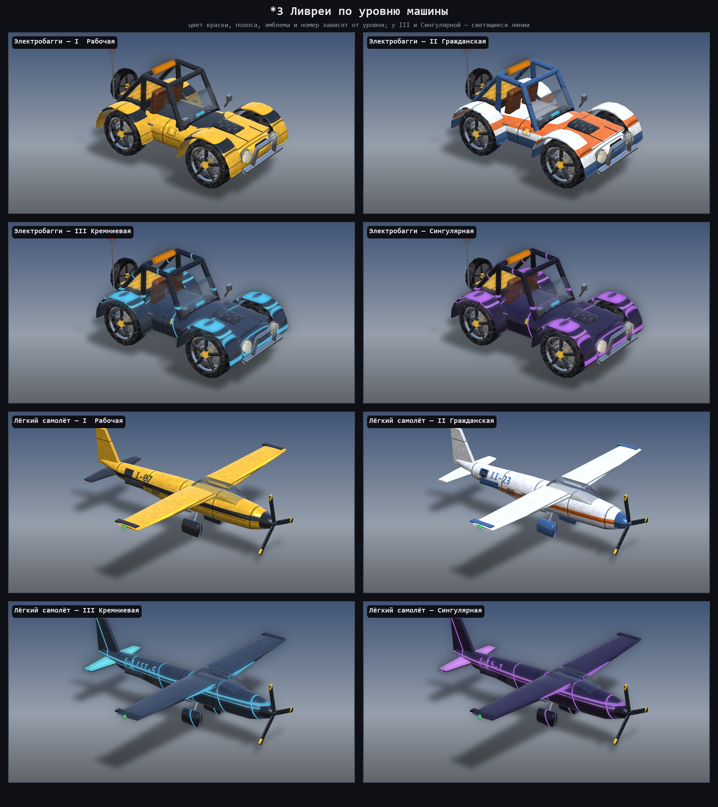

# Silicon Age: Vehicles

  

**[Русский](#русский) | [English](#english)**

---

## Русский

**Кремниевый век: Техника** — аддон к моду [Silicon Age](https://github.com/cani2223322-ux/SiliconAge) для Minecraft 1.7.10: десять машин от электробагги до сингулярного корабля, их зарядка, заправка газами и сборка на Инженерном верстаке. У каждой машины своя ниша: груз, группа игроков, тяжёлая работа, дальние перелёты, ранняя мобильность. Машины заряжаются EU, газы ядра дают особые режимы (подъём, охлаждение, форсаж, поле корпуса, кислород, дальние прыжки). Крафты — только из предметов Silicon Age и ванили.

> ⚠️ **Альфа-версия 0.1.0.** Всё основное работает и покрыто автотестами, но многое ещё не обкатано в игре. Возможны ошибки — делайте резервные копии миров и пишите о проблемах в [Issues](https://github.com/cani2223322-ux/SiliconAgeVehicles/issues).

### Машины
| Машина | Ур. | Буфер EU | Скорость | Мест | Груз | Особенность |
|---|---|---|---|---|---|---|
| Электробагги | MV | 400 тыс. | 36 км/ч | 2 | 9 | первая машина, разведка |
| Ховербайк | QV | 4 млн | 60 км/ч | 1 | 9 | висит над землёй, водой и лавой на водороде |
| Лёгкий вертолёт | HV | 3 млн | 50 км/ч | 2 | 9 | вертикальный взлёт, висение, авторотация |
| Лёгкий самолёт | HV | 4 млн | 81 км/ч | 3 | 9 | дёшево далеко, разбег, полоса ×0,5 |
| Грузовой вездеход | HV | 2 млн | 28 км/ч | 2 | 54 (+54 прицеп) | гусеницы, прицеп, автодоставка A ↔ B |
| Буровая машина | EV | 8 млн | 12 км/ч | 1 | 108 | туннели 3×3 / 5×5, «только руда», выравнивание |
| Реактивный самолёт | QV | 16 млн | 121 км/ч | 1 | 9 | форсажная камера (до 180 км/ч) |
| Конвертоплан | XV | 32 млн | 101 км/ч | 6 | 27 | вертикальный режим + режим самолёта |
| Транспортный челнок | XV | 32 млн | 81 км/ч | 8 | 27 | герметичная кабина с O₂, «Дальний режим» на дейтерии, стыковка с мостом ядра |
| Сингулярный корабль | SV | 256 млн | 121 км/ч | 6 | 54 | свой портал «Прыжок», гравитационный якорь, невидимость для мобов |

- **Авиация** летает до Y 200; без мощности вертолёты уходят в авторотацию, самолёты планируют 1:8; седоки не получают урона от падения. Скорость любой машины — не больше 180 км/ч (сервер успевает загружать мир).
- **Транспортный челнок**: свободный полёт во все стороны, 200 EU/т; экипаж дышит кислородом кабины под водой (1 мБ/с на человека); выше Y 120 на скорости «Дальний режим» тратит дейтерий 1 мБ/с вместо EU. Влетите в открытый вихрь Наземного или Космического моста ядра — челнок пройдёт на другую сторону (и в другое измерение) вместе с людьми и грузом; нужен доступ к мосту, челнок сам платит за массу перехода.
- **Сингулярный корабль**: всё, что умеет челнок, быстрее, 400 EU/т; «Прыжок» открывает портал к точке Координатора ядра в багажнике или домой (кровать пилота): от 16 блоков, 20 млн EU + 2 млн за 1000 блоков и 10 мБ + 10 за 1000 блоков сингулярной материи (в другое измерение — 100 млн EU и 100 мБ), перезарядка 30 с, место прибытия должно быть свободно и не в чужом привате. «Гравитационный якорь» держит корабль неподвижно (40 EU/т), «Невидимость» прячет экипаж от враждебных мобов (1 мБ/с СМ). Сингулярность над корпусом пульсирует.
- **Износ корпуса** (конфиг `vehicles.wear`), нагрев с остановкой мотора (гелий охлаждает), аварийный ход без заряда, владелец и доступ, чужие приваты не трогаются, лимит машин на игрока (`vehicles.maxPerPlayer`).

### Внешний вид и кабины
- **Текстуры и ливреи:** фактура материалов 16×16, швы и заклёпки; ливрея по уровню машины (I рабочая с чёрно-жёлтой полосой, II гражданская, III кремниевая со светящимися линиями, Сингулярная — с фиолетовыми); на бортах эмблема SA, личный бортовой номер и лючок зарядки.
- **Свет:** лучи фар и подсветка блоков впереди ночью, стоп-сигналы, бортовые огни авиации (красный / зелёный, строб, маячок), оранжевые маячки вездехода и буровой.
- **Анимации:** колёса, руление, гусеницы, элероны и рули, уборка шасси, наклон винта вертолёта, покачивание ховербайка, искры бура; седоки наклоняются вместе с корпусом.
- **Кабины:** мир виден только через стёкла; приборные панели под каждый тип (автомобильный щиток, вертолётная кабина с верхним пультом и окном в полу, «шестёрка» самолёта); живые стрелки и экраны (скорость, высота, заряд, авиагоризонт, курс), лампы с ролями и реакцией на события, запуск с тестом ламп; подвижные руль, ручка, шаг-газ, штурвал, РУД и педали; отделка салона по уровню; ночная подсветка в цвет уровня.
- **Предметы-машины** — вращающиеся 3D-модели в инвентаре.

### Вождение
- **Звуки:** у каждой машины свой синтезированный звук, тон зависит от скорости и нагрузки, в закрытой кабине тише.
- **Камера техники** от третьего лица — дальше по размеру машины, плавная; колёсико меняет дистанцию.
- **Круиз-контроль** (O) у наземных машин и ховербайка, **автопилот** самолётов (курс + высота).
- **Дороги:** асфальт (+30% скорости, износ ×0,5), бетон (+20%), разметка, бордюр, знаки, светофор от редстоуна, отбойник.

### Мастерская и логистика
- **Ремонтный гараж:** контроллер + плиты пола; ремонт корпуса и остывание мотора за EU и сталь, голограмма, выход компаратора.
- **Тюнинг** (до 4 на машину, ставится в гараже): Мотор+ I/II, Аккумулятор+, Броня, Лёгкий корпус, Большие колёса, Люстра фар, Усиленный бур, Доп. бак — видно на модели.
- **Ключ-карта и права:** Водить / Пассажир / Багажник / Ремонт для каждого игрока, режимы Открыта / Друзья / Владелец, смена замка.
- **Прицепы вездехода:** грузовой, цистерна (16 000 мБ жидкости или газа, заправка техники рядом), платформа (везёт багги или ховербайк), передвижная зарядка (4 млн EU, солнце).
- **Карта техники** (M или кнопка на станции): где ваши машины, их заряд и износ.

### Блоки и предметы
- **Инженерный верстак** (MV): сетка 5×5, делает все компоненты (3×3, мгновенно) и все машины (5×5, EU и время); слоты улучшений ядра — Трансформаторный модуль нужен машинам QV–SV (вход HV–IV).
- **Зарядная станция техники** + **плиты зарядной платформы** (обычная, «H», с огнём): площадка любой формы, 3×3 / 3×5 / 5×5 / 7×7 по размеру машины, бонус за лишние плиты; модули газа, ремонта и доступа.
- **Газовая колонка** (HV): баки всех газов ядра, заправляет машины владельца рядом.
- **Взлётно-посадочная полоса**: разбег самолётов ×0,5, мягкое торможение, огни по краю.
- **Прицеп** вездехода; 24 компонента (колесо, гусеница, моторы, турбо-, антигравитационный и сингулярный двигатели, винт, крыло, бортовой компьютер, газовый бак, кабина, корпуса I–V, энергоблоки MV–SV, расширитель бура).

### Управление
| Клавиша | Действие |
|---|---|
| **ПКМ** по машине | Сесть (владелец — за руль, остальные — пассажирами) |
| **Shift + ПКМ** | Багажник (и кнопка «Убрать в инвентарь»); гаечный ключ ядра — сразу в инвентарь |
| **W / S, A / D** | Газ / тормоз и задний ход, поворот (у авиации — вперёд / назад, разворот) |
| **Пробел** | Тормоз; ховербайк — выше; вертолёт, челнок, корабль — вверх; самолёт — нос вверх |
| **X** («Снижение»), **Ctrl** (бег) | Авиация — вниз / нос вниз |
| **F** («Форсаж») | Ховербайк, реактивный, конвертоплан, челнок, корабль |
| **B** | Бур: вкл / выкл |
| **N** («Режим») | Режим бура; конвертоплан — вертикальный / самолёт; челнок и корабль — «Дальний режим» |
| **V** | «Прыжок» (Сингулярный корабль) |
| **Y** | Цель прыжка: Координатор / дом |
| **Z** | Гравитационный якорь |
| **C** | Невидимость для мобов |
| **Shift** (выйти) | Встать с места |
| ПКМ ячейкой / ведром газа | Заправить машину (может любой) |
| ПКМ Координатором ядра | Точки A / B автодоставки вездехода |
| **L** («Багажник») | Багажник, сидя в машине |
| **O** («Круиз») | Круиз-контроль / автопилот |
| **Колёсико** | Дистанция камеры; при круизе — скорость ±5 км/ч |
| **M** | Карта техники |
| Пустая ключ-карта: ПКМ / Shift + ПКМ по машине | Карта владельца / окно доступа |

Все клавиши переназначаются в настройках управления (раздел «Кремниевый век: Техника»).

### Требования и установка
1. Minecraft **1.7.10**, Forge **10.13.4.1614** (или новее для 1.7.10), Java 8.
2. Мод **[Silicon Age](https://github.com/cani2223322-ux/SiliconAge/releases) 0.1.8** или новее (обязателен).
3. Положите jar аддона в папку `.minecraft/mods` рядом с Silicon Age. IndustrialCraft 2 — необязателен, как и для ядра.
4. NEI (Not Enough Items) — необязателен: если он установлен, все рецепты Инженерного верстака видны в NEI (страница «Инженерный верстак»: сетка 5×5, EU, время, нужный вход и трансформаторы). R — как сделать, U — где используется (и U по самому верстаку — все рецепты), клик по стрелке в окне верстака — список рецептов, «?» — подсказка раскладки в сетке, Shift + «?» — разложить, как кнопкой «Разложить». Без NEI аддон работает как обычно.

### Сборка из исходников
1. JDK 8 и Gradle 2.14 (ForgeGradle 1.2).
2. Рядом должен лежать проект ядра `../SiliconAge` с собранными классами (`build/classes/main`), в `libs/` — `industrialcraft-2-2.2.828-experimental.jar` и для плагина NEI `NotEnoughItems-1.7.10-1.0.5.120-universal.jar`, `CodeChickenCore-1.7.10-1.0.7.48-universal.jar`, `CodeChickenLib-1.7.10-1.1.3.141-universal.jar` (только для компиляции, в jar не попадают; берутся из `../SiliconAge/libs`).
3. `gradle build` — jar появится в `build/libs/`.

### Настройки
Всё новое выключается в `config/SiliconAgeVehicles.cfg` (раздел `vehicles`): `textures`, `liveries`, `headlights`, `dynamicLight`, `navLights`, `animations`, `liveInstruments`, `icons3d`, `interiorTrim`, `nightLighting`, `cockpitStartup`, `cockpitSounds`, `sounds`, `vehicleCamera`, `cruise`, `autopilot`, `tuning`, `locks`, `trailerKinds`, `vehicleMap` и другие.

### Лицензия
© 2026 Aleksandr. Все права защищены. Код открыт для просмотра; копирование, изменение и распространение (в том числе в сборках) — только с разрешения автора.

---

## English

**Silicon Age: Vehicles** is an add-on to the [Silicon Age](https://github.com/cani2223322-ux/SiliconAge) mod for Minecraft 1.7.10: ten vehicles from an electric buggy to a singular ship, their charging, gas refuelling and assembly on the Engineering Workbench. Every vehicle has its own niche: cargo, a group of players, heavy work, long trips, early mobility. Vehicles run on EU; the core's gases power the special modes (lift, cooling, afterburner, hull field, oxygen, long jumps). Recipes use only Silicon Age and vanilla items.

> ⚠️ **Alpha 0.1.0.** Everything main works and is covered by automated tests, but much is not yet played through in game. Expect bugs: back up your worlds and report problems in [Issues](https://github.com/cani2223322-ux/SiliconAgeVehicles/issues).

### Vehicles
| Vehicle | Tier | EU buffer | Speed | Seats | Cargo | Special |
|---|---|---|---|---|---|---|
| Electric Buggy | MV | 400k | 36 km/h | 2 | 9 | the first vehicle, scouting |
| Hoverbike | QV | 4M | 60 km/h | 1 | 9 | hovers over ground, water and lava on hydrogen |
| Light Helicopter | HV | 3M | 50 km/h | 2 | 9 | vertical take-off, hover, autorotation |
| Light Plane | HV | 4M | 81 km/h | 3 | 9 | cheap long trips, take-off run, runway x0.5 |
| Cargo Crawler | HV | 2M | 28 km/h | 2 | 54 (+54 trailer) | tracks, trailer, A ↔ B auto-delivery |
| Drilling Vehicle | EV | 8M | 12 km/h | 1 | 108 | 3x3 / 5x5 tunnels, ore only, levelling |
| Jet | QV | 16M | 121 km/h | 1 | 9 | afterburner (up to 180 km/h) |
| Tiltrotor | XV | 32M | 101 km/h | 6 | 27 | vertical mode + airplane mode |
| Transport Shuttle | XV | 32M | 81 km/h | 8 | 27 | sealed cabin with O₂, long-range mode on deuterium, core bridge docking |
| Singular Ship | SV | 256M | 121 km/h | 6 | 54 | its own portal (Jump), gravity anchor, invisibility to mobs |

- **Aircraft** fly up to Y 200; without power helicopters autorotate, planes glide 1:8; seated riders take no fall damage. No vehicle goes faster than 180 km/h (the server keeps loading the world ahead).
- **Transport Shuttle**: free flight in every direction, 200 EU/t; the crew breathes the cabin's oxygen under water (1 mB/s a person); above Y 120 at speed the long-range mode burns deuterium 1 mB/s instead of EU. Fly into an open vortex of the core's Ground or Space Bridge and the shuttle comes out on the other side (another dimension too) with its people and cargo; the pilot needs access to the bridge, the shuttle pays the pass's mass toll itself.
- **Singular Ship**: everything the shuttle does, faster, 400 EU/t; the Jump opens a portal to the point of a core Coordinator in its cargo or home (the pilot's bed): 16 blocks or more, 20M EU + 2M per 1000 blocks and 10 mB + 10 per 1000 blocks of singular matter (another dimension - 100M EU and 100 mB), a 30 s cooldown, the arrival spot must be free and not in a foreign private field. The Gravity Anchor holds the ship still (40 EU/t), Invisibility hides the crew from hostile mobs (1 mB/s SM). The singularity over the hull pulses.
- **Hull wear** (config `vehicles.wear`), motor heat with a stall (helium cools), limp mode without charge, owner and access, foreign private fields are never touched, a per-player vehicle limit (`vehicles.maxPerPlayer`).

### Look and cockpits
- **Textures and liveries:** 16x16 material textures, panel seams and rivets; a livery by tier (I work with a black-yellow band, II civil, III silicon with glowing lines, Singular with purple ones); an SA emblem, a personal board number and a charge hatch on the sides.
- **Lights:** headlight beams and block light ahead at night, brake lights, aircraft navigation lights (red / green, strobe, beacon), amber beacons on the crawler and the drill.
- **Animations:** wheels, steering, tracks, ailerons and rudders, retracting gear, helicopter rotor tilt, hoverbike bob, drill sparks; riders lean with the body.
- **Cockpits:** the world shows only through the glass; a dashboard per type (car cluster, helicopter cockpit with an overhead panel and a floor window, the plane's six-pack); live needles and screens (speed, altitude, charge, attitude, heading), lamps with roles that react to events, a start-up lamp test; moving wheel, cyclic, collective, yoke, throttle and pedals; interior trim by tier; night lighting in the tier colour.
- **Vehicle items** are rotating 3D models in the inventory.

### Driving
- **Sounds:** every vehicle has its own synthesized sound, pitch follows speed and load, quieter inside a closed cabin.
- **Vehicle camera** in third person: farther by the vehicle's size, smooth; the mouse wheel changes the distance.
- **Cruise control** (O) for ground vehicles and the hoverbike, **autopilot** for planes (heading + altitude).
- **Roads:** asphalt (+30% speed, wear x0.5), concrete (+20%), markings, curb, signs, a redstone traffic light, guard rail.

### Workshop and logistics
- **Repair garage:** a controller + floor plates; repairs the hull and cools the motor for EU and steel, hologram, comparator output.
- **Tuning** (up to 4 per vehicle, fitted in the garage): Motor+ I/II, Battery+, Armour, Light hull, Big wheels, Light bar, Reinforced drill, Extra tank - visible on the model.
- **Key card and access:** Drive / Passenger / Cargo / Repair per player, modes Open / Friends / Owner, change the lock.
- **Crawler trailers:** cargo, tanker (16,000 mB of a fluid or gas, refuels vehicles nearby), platform (carries a buggy or hoverbike), mobile charger (4M EU, solar).
- **Vehicle map** (M or the station button): where your vehicles are, their charge and wear.

### Blocks and items
- **Engineering Workbench** (MV): a 5x5 grid, makes every component (3x3, instant) and every vehicle (5x5, EU and time); core upgrade slots - QV-SV vehicles need Transformer upgrades (HV-IV input).
- **Vehicle Charging Station** + **charging platform plates** (plain, "H", edge light): a platform of any shape, 3x3 / 3x5 / 5x5 / 7x7 by the vehicle's size, a bonus for extra plates; gas, repair and access modules.
- **Gas Column** (HV): tanks of every core gas, refuels its owner's vehicles nearby.
- **Runway**: plane take-off run x0.5, soft braking, edge lights.
- The crawler's **Trailer**; 24 components (wheel, track, motors, turbo, antigravity and singular engines, rotor, wing, on-board computer, gas tank, cabin, hulls I-V, energy blocks MV-SV, drill widener).

### Controls
| Key | Action |
|---|---|
| **Right-click** a vehicle | Get in (the owner drives, others ride as passengers) |
| **Shift + right-click** | Cargo (and the "Pick up" button); a core wrench - straight into the inventory |
| **W / S, A / D** | Throttle / brake and reverse, steer (aircraft: forward / back, turn) |
| **Space** | Brake; hoverbike - higher; helicopter, shuttle, ship - up; plane - nose up |
| **X** (Descend), **Ctrl** (sprint) | Aircraft - down / nose down |
| **F** (Boost) | Hoverbike, jet, tiltrotor, shuttle, ship |
| **B** | Drill on / off |
| **N** (Mode) | Drill mode; tiltrotor - vertical / airplane; shuttle and ship - long-range mode |
| **V** | Jump (Singular Ship) |
| **Y** | Jump target: Coordinator / home |
| **Z** | Gravity anchor |
| **C** | Invisibility to mobs |
| **Shift** (dismount) | Get off |
| Right-click with a gas cell / bucket | Refuel the vehicle (anyone may) |
| Right-click with a core Coordinator | The crawler's auto-delivery points A / B |
| **L** (Cargo) | Cargo while seated |
| **O** (Cruise) | Cruise control / autopilot |
| **Mouse wheel** | Camera distance; with cruise on - speed ±5 km/h |
| **M** | Vehicle map |
| A blank key card: right-click / Shift + right-click a vehicle | Owner card / access screen |

Every key can be rebound in the controls settings ("Silicon Age: Vehicles").

### Requirements and installation
1. Minecraft **1.7.10**, Forge **10.13.4.1614** (or newer for 1.7.10), Java 8.
2. **[Silicon Age](https://github.com/cani2223322-ux/SiliconAge/releases) 0.1.8** or newer (required).
3. Put the add-on jar into `.minecraft/mods` next to Silicon Age. IndustrialCraft 2 is optional, as for the core.
4. NEI (Not Enough Items) is optional: with it every Engineering Workbench recipe shows in NEI (the "Engineering Workbench" page: 5x5 grid, EU, time, required input and transformers). R - how to make, U - where it is used (U on the workbench itself - all recipes), clicking the arrow in the workbench screen lists the recipes, "?" shows the layout over the grid, Shift + "?" lays it out like the "Lay out" button. Without NEI the add-on works as usual.

### Building from source
1. JDK 8 and Gradle 2.14 (ForgeGradle 1.2).
2. The core project `../SiliconAge` must sit next to it with its classes built (`build/classes/main`); `libs/` holds `industrialcraft-2-2.2.828-experimental.jar` and, for the NEI plugin, `NotEnoughItems-1.7.10-1.0.5.120-universal.jar`, `CodeChickenCore-1.7.10-1.0.7.48-universal.jar`, `CodeChickenLib-1.7.10-1.1.3.141-universal.jar` (compile only, never packed into the jar; copy them from `../SiliconAge/libs`).
3. `gradle build` - the jar appears in `build/libs/`.

### Configuration
Everything new can be switched off in `config/SiliconAgeVehicles.cfg` (category `vehicles`): `textures`, `liveries`, `headlights`, `dynamicLight`, `navLights`, `animations`, `liveInstruments`, `icons3d`, `interiorTrim`, `nightLighting`, `cockpitStartup`, `cockpitSounds`, `sounds`, `vehicleCamera`, `cruise`, `autopilot`, `tuning`, `locks`, `trailerKinds`, `vehicleMap` and more.

### License
© 2026 Aleksandr. All rights reserved. The code is open to read; copying, changing and distributing it (in modpacks too) only with the author's permission.
